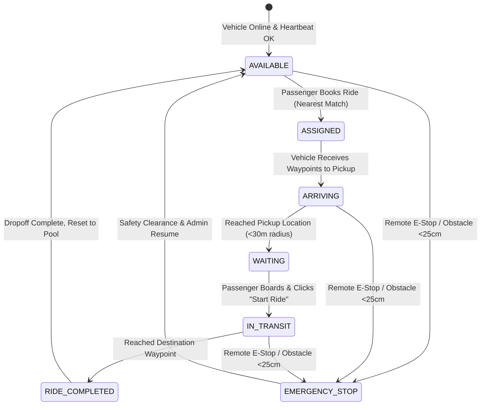

# DriveAI - System Architecture Specification

## 1. Executive Summary

DriveAI is an integrated autonomous robotic taxi system that connects a physical self-driving robotic car with a real-time web ride-hailing platform. The system operates on a decentralized hierarchical architecture where high-level mission planning, user dispatch, and computer vision occur on compute servers and onboard edge computers (NVIDIA Jetson Nano), while low-level real-time actuator control, ultrasonic safety interrupts, and motor PWM drive occur on dedicated real-time microcontrollers (ESP32).

---

## 2. End-to-End System Architecture

```
+---------------------------------------------------------------------------------------+
|                                    PASSENGER APP & ADMIN UI                           |
|  - Modern React / Tailwind CSS / Leaflet Map                                          |
|  - Real-time GPS Tracking, Speedometer HUD, Battery Gauge, Emergency Stop Controls   |
+-------------------------------------------+-------------------------------------------+
                                            ^
                         HTTP REST & WebSocket (bi-directional)
                                            v
+---------------------------------------------------------------------------------------+
|                                  DRIVEAI BACKEND SERVER                               |
|  - High-performance FastAPI Asynchronous Server                                      |
|  - Autonomous Dispatcher & Waypoint Interpolation Engine                              |
|  - SQLite / PostgreSQL WAL Database                                                   |
|  - WebSocket Hub (/ws/taxi, /ws/passenger, /ws/admin)                                 |
+-------------------------------------------+-------------------------------------------+
                                            ^
                                     WebSocket / Wi-Fi
                                            v
+---------------------------------------------------------------------------------------+
|                           ONBOARD ROBOTIC VEHICLE COMPUTER                            |
|                                 (NVIDIA Jetson Nano)                                  |
|  - Autonomous Vehicle Agent (Python Async State Machine)                              |
|  - OpenCV Computer Vision Obstacle Detection & Sensor Fusion Pipeline                 |
|  - Pure Pursuit / GPS Waypoint Path Following Navigator                               |
|  - High-Frequency Telemetry Streamer (5-10 Hz)                                        |
+-------------------------------------------+-------------------------------------------+
                                            ^
                              High-Speed Serial UART (115200 Baud)
                                            v
+---------------------------------------------------------------------------------------+
|                             LOW-LEVEL SAFETY CONTROLLER                               |
|                                    (ESP32 DevKit)                                     |
|  - Hardware Watchdog Timer (800ms fail-safe cutoff)                                   |
|  - Ultrasonic Radar Collision Hard-Stop Interrupt (< 25cm)                            |
|  - Dual H-Bridge Motor PWM Kinematics (L298N / TB6612FNG)                             |
+-------------------------------------------+-------------------------------------------+
                                            |
                                            v
                                 [Actuators & Chassis]
                                 - 4x High-Torque Geared DC Motors
                                 - HC-SR04 Ultrasonic Sensors
                                 - Hardware Emergency Pushbutton
```

---

## 3. Autonomous Ride Lifecycle & State Machine



---

## 4. Subsystem Division of Responsibilities

### Tier 1: Cloud / Backend Server
- **Authentication**: JWT token-based authentication with bcrypt hashing.
- **Dispatch Algorithm**: Computes Great-Circle Haversine distance from all available vehicles to passenger pickup location, selecting the nearest unencumbered vehicle.
- **Path Waypoint Interpolation**: Synthesizes urban road navigation routes with Manhattan-style coordinate turning steps.
- **WebSocket Broker**: Maintains open sockets to vehicles, passenger clients, and fleet controllers with low-latency broadcasts.

### Tier 2: Vehicle Edge Computer (Jetson Nano)
- **Wayfinding**: Translates server waypoints into target headings and angular steering corrections using Pure Pursuit geometry.
- **Computer Vision**: Captures real-time camera frames at 30 FPS, runs contour and edge analysis across the forward driving corridor to identify obstructions.
- **Sensor Fusion**: Correlates vision findings with real-time ultrasonic range measurements from the ESP32.
- **State Supervision**: Transitions vehicle states (`ARRIVING`, `WAITING`, `IN_TRANSIT`, `RIDE_COMPLETED`) and streams telemetry at 5 Hz.

### Tier 3: Real-Time Motor & Safety Microcontroller (ESP32)
- **Motor Control**: Applies pulse-width modulation (PWM) to the H-bridge motor driver for smooth acceleration and differential steering.
- **Ultrasonic Collision Interrupt**: Independently samples HC-SR04 echo pulses. If an obstacle is detected within 25 cm, it immediately overrides serial throttle to 0 and brings motors to an instantaneous stop.
- **Watchdog Fail-Safe**: If serial communication from the Jetson Nano drops for more than 800ms, the ESP32 automatically halts all motors to prevent uncontrolled runaway.
